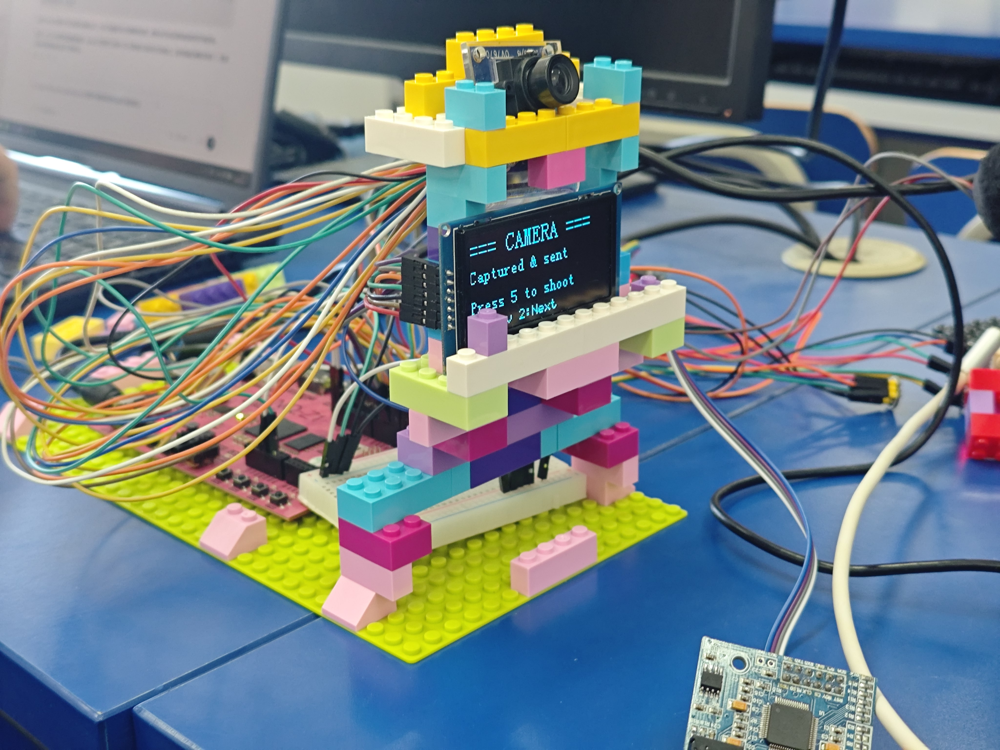
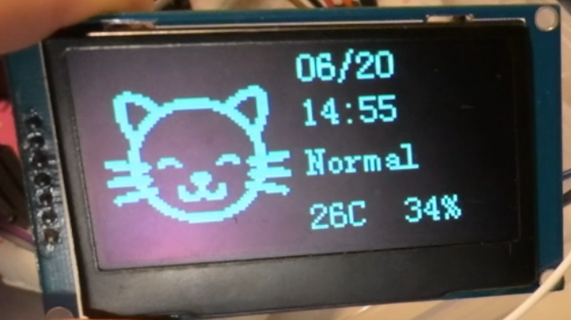

# PynqPet

A reactive table pet driven by LLMs.

<p align="center">
  
  
</p>

## Checklist

- Pynq-Z1
- ESP32-C3-SuperMini
- SSD1309
- LCM1027A2445F
- 4*4 Keyboard
- OV7670
- DS3231RTC
- DHT11
- XFS5152
- INMP441

## Architecture

```text
                  +---------------------+
+-------------+   |       PYNQ-Z1       |
| Peripherals |<->|   PL   <->   PS     |
+-------------+   +---------------+-----+
                                  ^
                                  |
                                  v
                           +------------+
                           |  ESP32-C3  |
                           +-----+------+
                                 ^
                                 | WebSocket
                                 v
                       +------------------+
                       |  BackendWrapper  |
                       +---------+--------+
                                 ^
                                 | WebSocket
                                 v
                       +------------------+
                       | Open-LLM-VTuber  |
                       +------------------+
```
## Setup

### Server

This project uses [Open-LLM-VTuber](https://github.com/Open-LLM-VTuber/Open-LLM-VTuber) as an upstream service. Deploy it first and enable [cmd_prompt](docs/cmd_prompt.txt) for it.

`BackendWrapper` use `uv` to manage dependencies too.

### Client

Build the hardware platform with files in `vivado_files/`.

## Start

Power on the client first and run:

```bash
cd /path/to/Open-LLM-VTuber
uv run run_server.py

cd /path/to/BackendWrapper
export PYNQ_PET_UPSTREAM_MODE = 'open_llm_ws'
export PYNQ_PET_OPEN_LLM_WS_URL = 'ws://127.0.0.1:12393/client-ws'
uv run uvicorn main:app --host 0.0.0.0 --port 8000
```

## License

The source owned by the project authors is licensed under the [MIT License](LICENSE).

Third-party component is subject to its license:

AMD IP supplied with Vivado, including corresponding components in generated artifacts, is subject to the [Vivado ML End User License Agreement](https://www.xilinx.com/support/documents/sw_manuals/xilinx2023_1/ug1593_vivado_ml_eulas.pdf) and is excluded from the MIT license granted by the project authors.
